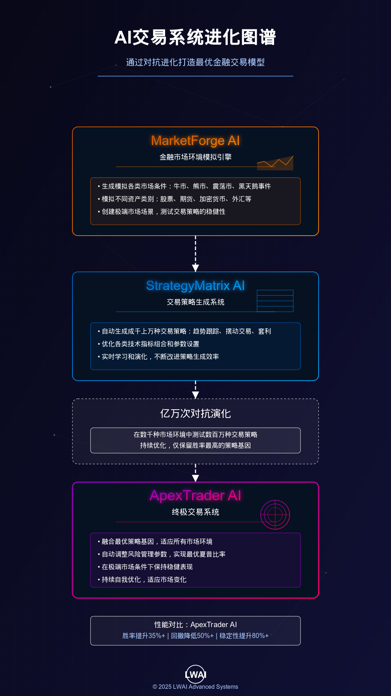

# 关于量化交易的一切功能、策略、指标、因子等，只要你想得出来能描述清楚，LW基本可以实现，这仓库只做功能请愿没任何代码，将你们想要的一切说出来！！！点击左上方Issues请愿！
#  LWAI 私有化的本地看盘+量化分析工具+策略因子发掘工具

一个属于自己的「安全+本地+高效的 TradingView」。
用图表引擎 + Pine 脚本引擎，直接把运行在tradingview的K线与指标画出来，
并叠加自己写的 LWAI 体系指标。

数据来源是新浪财经的免费接口，不需要付费、不需要 API Key。
省了tradingview的订阅与数据费用。要实时的需要购买付费API。
方便AI本地化策略因子开发、研究、部署等
---

它是什么
一个跑在浏览器里的本地化高效看盘工具。
用 Pine 脚本（TradingView 同款语言）写指标。
数据来自新浪，免费，非实时（盘后/延时数据）。
指标是私有的，只有你自己能用。
能做什么
画 A 股 K 线。
多图布局：默认左右两图（左日线、右周线）。
每个图独立切换周期，互不影响。
拼音搜股：输入首字母即可，比如 gzmt 找到贵州茅台。
加载自己写的 Pine 指标。
显示 LWAI 体系各种指标。
指标参数调整与指标模板（保存、应用、删除）。
保存/恢复整张图的状态，刷新不丢。
自动计算流通股本、总股本、流通占比等。
前复权处理（价格、分红、成交量都复权），历史价格更准确。
一键更新依赖，自动备份上一个版本，出问题一键回滚。
测试标的
默认用的是贵州茅台：

sina:600519$SH
主图日线（1D），副图周线（1W）。

项目结构
vela-ts/
├── main.js                # 入口：布局、多图同步、指标、插件
├── config.js              # 配置
├── vite.config.js         # Vite 配置
├── sina-provider.js       # 新浪数据源（K线 + 股本 + 复权）
├── itick-provider.js      # 备选数据源
├── provider-interface.js  # 数据源接口
├── save-chart.js          # 保存/恢复整张图状态
├── template-manager.js    # 指标模板（保存、列表、应用、删除）
├── indicator-params.js    # 指标参数管理
├── index.html             # 页面
├── package.json           # 依赖清单 + 命令
├── scripts/
│   └── update.mjs         # 一键更新 / 回滚脚本
├── indicators/            # Pine 指标脚本目录
│   ├── LWAI筹码分布.pine   # 筹码分布指标
│   └── LWAI流动性热图.pine  # 流动性热图指标
├── .backups/              # 更新备份（不上传 GitHub）
├── 启动.command            # Mac 一键启动
└── 说明.txt                # 本地说明
环境要求
Node.js 20.19 以上，或 22.12 以上（Vite 8 的要求）。
查看版本：
node -v
怎么跑起来
装依赖：
npm install
启动开发服务器：
npm run dev
浏览器会自动打开 http://localhost:5173。
Mac 用户也可以直接双击 启动.command 一键启动。

常用命令
命令	作用
npm run dev	启动网页
npm run update	一键更新依赖（先备份）
npm run update -- --yes	跳过确认，直接更新
npm run rollback	还原到更新前的版本
怎么更新依赖
在运行 npm run dev 的终端按 Control + C 停掉网页。
运行：
npm run update
看清列出的「旧版本 → 新版本」：
小更新（如 0.8.4 → 0.8.5）：放心按 y。
大版本（第一个数字变了，如 8.x → 9.x）：建议先按 n。
更新后 npm run dev，测试网页、多图、拼音搜股、指标。
有问题就运行 npm run rollback。
说明：

备份放在 .backups/prev，只保留上一个版本。
更新范围只含依赖包，不会改动自己写的代码。
安装失败或依赖检查失败时，脚本会自动回滚。
技术栈
组件	版本	作用
@luxalgo/vela	0.8.4	图表渲染引擎（K 线、指标线、多图）
@luxalgo/vela-pinets	0.2.16	Vela 与 PineTS 的桥接
pinets	0.11.1	Pine 脚本转译与执行引擎
pinyin-pro	3.29.5	拼音搜股
vite	8.3.4	开发服务器
JavaScript：主要开发语言。
新浪财经：免费行情与股本数据源。
数据源说明
SinaProvider（sina-provider.js）负责：

抓取 K 线数据。
抓取股本信息（用于流通股本 / 总股本）。
处理分红配股，做前复权（含成交量复权）。
股票名单本地缓存（约 5000+ 只），减少重复请求。
做成数据插头，既可以用免费源，也可以换付费实时行情 API。
已知事项
某个 .pine 指标的 max_lines_count=1000，
超过 vela-pinets 上限 500，控制台会出黄色警告，指标仍能运行。
部分指标在周线图上提示 unanchored，待排查。
新浪免费数据非实时。
烧了老王 N 多 token。
更新日志
2026-10-14
升级 Vela 0.8.4、vela-pinets 0.2.16、pinets 0.11.1。
多图布局，每个图可独立切换周期。
新增拼音搜股（pinyin-pro）。
升级 Vite 5.4.21 → 8.3.4。
新增 npm run update / npm run rollback 一键更新与回滚。
使用说明
本地一键启动：双击 启动.command，
或在项目目录运行 npm run dev。
