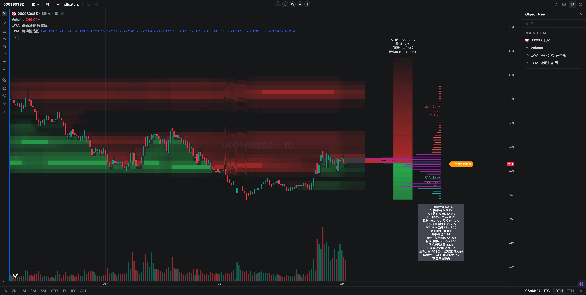
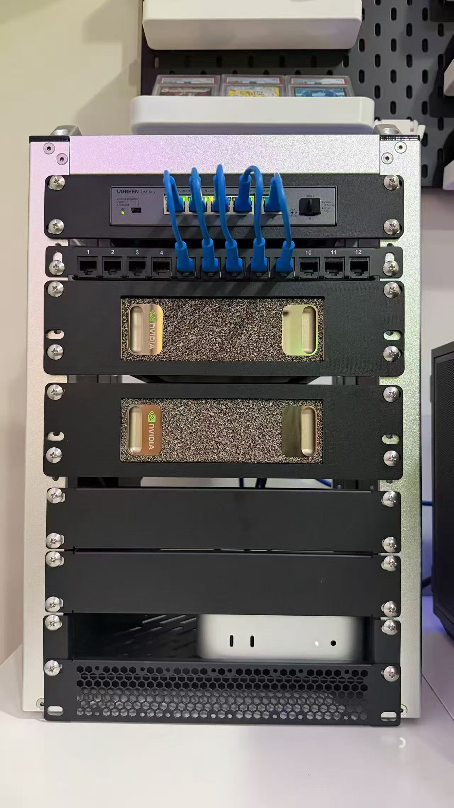

# 功能请愿墙，这仓库只做功能请愿没任何代码，将你们想要的功能说出来！！！点击左上方Issues请愿！
#  LWAI 私有化的本地看盘+量化分析工具

一个属于自己的「安全+本地+高效的 TradingView」。
用图表引擎 + Pine 脚本引擎，直接把运行在tradingview的K线与指标画出来，
并叠加自己写的 LWAI 体系指标。



数据来源是新浪财经的免费接口，不需要付费、不需要 API Key。
省了tradingview的订阅与数据费用。要实时的需要购买付费API。
方便AI本地化策略因子开发、研究、部署等
---

## 它是什么

- 一个跑在浏览器里的本地化高效看盘工具。
- 用 Pine 脚本（TradingView 同款语言）写指标。
- 数据来自新浪，实时免费。
- 指标是私有的，只有你自己能用。

---

## 能做什么

- 画 A 股日 K 线。
- 加载自己写的 Pine 指标。
- 显示 LWAI 体系各种指标。
- 自动计算流通股本、总股本、流通占比等。
- 前复权处理，历史价格更准确。

---

## 测试标的

默认用的是贵州茅台：

```
sina:600519$SH
```

日线周期（1D）。

---

## 项目结构

```
vela-ts/
├── main.js                  # 入口，加载指标和数据源
├── config.js                # 配置
├── vite.config.js           # Vite 打包配置
├── sina-provider.js         # 新浪数据源（K线+股本+复权）
├── itick-provider.js        # 备选数据源
├── provider-interface.js    # 数据源接口
├── save-chart.js            # 保存/恢复整张图状态（参数刷新不丢）
├── template-manager.js      # 指标模板（保存、列表、应用、删除，工具栏圆钮）
├── index.html               # 页面
├── package.json             # 依赖清单
├── indicators/              # Pine 指标脚本目录
│   ├── LWAI筹码分布.pine     # 筹码分布指标
│   └── LWAI流动性热图.pine    # 流动性热图指标
├── 启动.command             # Mac 一键启动
└── 说明.txt                 # 本地说明
```

---

## 怎么跑起来

1. 装依赖：

```bash
npm install
```

2. 启动开发服务器：

```bash
npm run dev
```

3. 浏览器打开提示的地址（默认一般是 localhost）。

Mac 用户也可以直接双击 `启动.command` 一键启动。

---

## 技术栈

- **Vela**：图表渲染引擎（画 K 线、指标线）。
- **PineTS**：Pine 脚本转译与执行引擎（跑 Pine 指标）。
- **Vite**：前端构建工具（开发服务器）。
- **JavaScript**：主要开发语言。
- **新浪财经**：免费行情与股本数据源。

---

## 数据源说明

`SinaProvider`（sina-provider.js）负责：

- 抓取日 K 线数据。
- 抓取股本信息（注册资本，用于流通/总股本）。
- 处理分红配股，做前复权。
- 本地缓存，减少重复请求。
- 做成数据插头，既可以免费，也可以使用付费实时行情API。

---

## 已知事项

- 烧了老王N多token

---

## 使用说明

本地一键启动：

